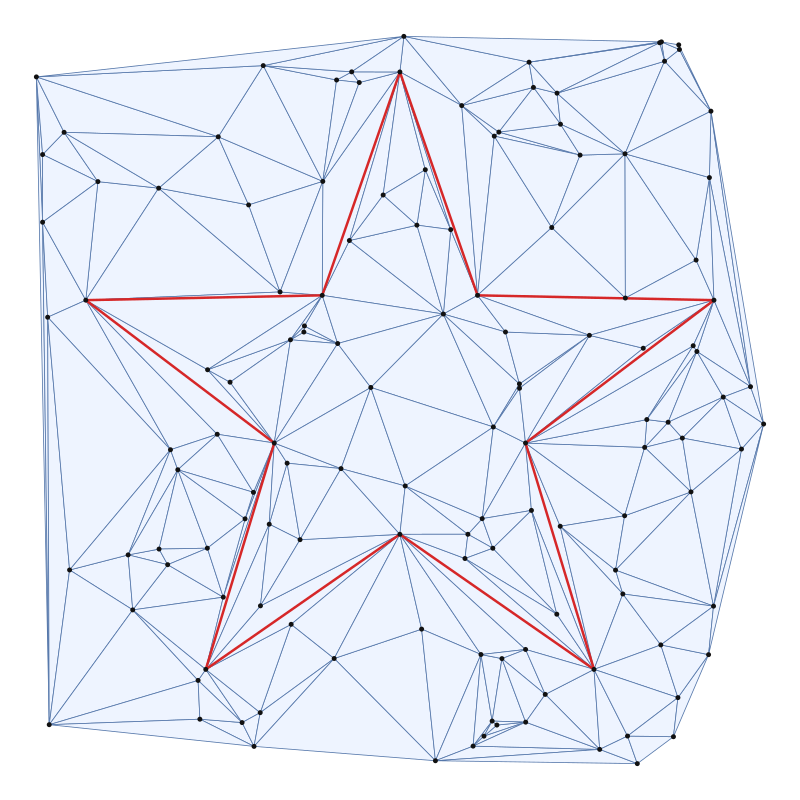
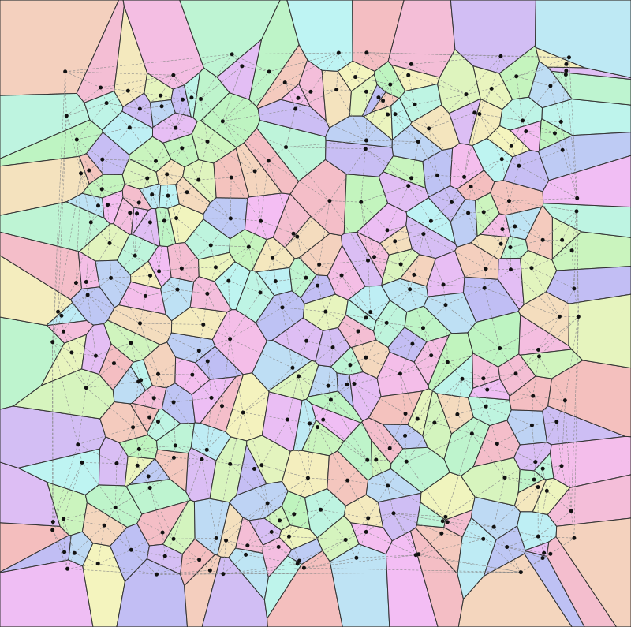

# delaunayd

Robust 2D computational geometry in D. It includes exact adaptive
predicates, convex hulls, Delaunay and constrained Delaunay triangulation,
point location and Voronoi diagrams, plus a `delaunayd` command-line tool
that prints text or SVG.

It uses Phobos only and has no dependencies. It works with LDC and DMD.

<p align="center">
  
  
</p>

## Why "robust"?

Geometric algorithms make their decisions with two predicates: *which side
of a line is this point on?* (`orient2d`) and *is this point inside that
circle?* (`incircle`). When these are evaluated naively in floating point,
inputs that are nearly collinear or nearly cocircular can get the wrong
answer, and a triangulation built on those answers can end up inconsistent:
overlapping triangles, infinite flip loops, crashes. delaunayd follows
Shewchuk's approach:

1. Evaluate the determinant in plain `double` arithmetic and compare it
   against a proven forward error bound.
2. Only if the result is too close to zero to trust, re-evaluate more
   precisely. `orient2d` goes through Shewchuk's stages B and C. Both
   predicates fall back to an **exact** evaluation using floating-point
   *expansions*, which are sums of non-overlapping doubles maintained with
   error-free transformations (`twoSum`, `twoProduct`, ...).

The sign is always exact, so you never need epsilons. Integer grids (where
everything is cocircular), duplicate points and long collinear runs all go
through the same code paths as random data. The predicate tests include
the classic counterexample from *Kettner et al., "Classroom examples of
robustness problems in geometric computations"*. On that input the naive
predicate gets orientations wrong, and the robust one agrees with a BigInt
reference on every point.

## Library

```d
import delaunayd;

auto pts = [Point(0, 0), Point(4, 0), Point(4, 3), Point(0, 3), Point(2, 1.5)];

// exact predicates
assert(orient2d(pts[0], pts[1], pts[2]) > 0);        // counterclockwise
assert(incircle(pts[0], pts[1], pts[2], pts[3]) == 0); // cocircular, exactly

// convex hull: strict corners, CCW from the lexicographically smallest point
size_t[] h = convexHull(pts);                         // [0, 1, 2, 3]

// Delaunay triangulation (flat half-edge arrays)
auto tr = delaunay(pts);
foreach (t; 0 .. tr.triangleCount)
{
    int[3] v = tr.triangle(t);                        // CCW vertex indices
}
auto loc = tr.locate(Point(1, 1));                    // inTriangle / onEdge / onVertex / outside
int[] ring = tr.neighbors(4);                         // CCW vertex star

// constrained Delaunay: force segments in
insertConstraint(tr, 0, 2);                           // split automatically at (2, 1.5)
assert(tr.isConstrained(0, 4) && tr.isConstrained(4, 2));

// Voronoi diagram
auto vd = voronoi(pts);
Point[] cell = vd.clippedCell(4, Box.around(pts, 0.1)); // CCW polygon
foreach (e; vd.edges()) { /* segment, ray or line */ }
```

| Module | Contents |
|---|---|
| `delaunayd.expansion` | Error-free transformations, plus zero-eliminating expansion sum, scale, product and sign |
| `delaunayd.predicates` | Adaptive `orient2d`/`incircle`, their exact versions, and `orientSign`/`incircleSign` |
| `delaunayd.hull` | Andrew's monotone chain `convexHull`, `polygonArea`, `inConvexPolygon` |
| `delaunayd.triangulation` | `Triangulation`/`delaunay`, vertex stars, edges, circumcenters, `locate` |
| `delaunayd.constrained` | `insertConstraint`, `constrainedDelaunay`, `ConstraintError` |
| `delaunayd.voronoi` | `Voronoi`/`voronoi`, `Box`, cell vertices, clipped cells, edges/rays |
| `delaunayd.io`, `delaunayd.svg`, `delaunayd.cli` | Text input format, SVG canvas, the CLI |

## Command line

```sh
dub build -b release          # produces ./delaunayd

./delaunayd triangulate examples/grid.txt          # text: points, triangles, constraints
./delaunayd triangulate --svg examples/star.txt -o star.svg
./delaunayd hull examples/random-300.txt
./delaunayd voronoi --svg --delaunay examples/random-300.txt -o voronoi.svg
./delaunayd locate 0.5 0.5 examples/random-300.txt
./delaunayd random 1000 --dist normal --seed 42 | ./delaunayd triangulate --svg -o cloud.svg
```

Input files have one point per line (`x y` or `x,y`). A line like `seg i j`
adds a constraint between points `i` and `j` (0-based, in file order). `#`
starts a comment. If the file is `-` or missing, input is read from stdin.
Text output prints coordinates with 17 significant digits, so they parse
back to the same doubles.

```
$ ./delaunayd triangulate examples/grid.txt | head -1
# delaunayd triangulate: 36 points (36 distinct), 50 triangles, 85 edges, 0 constrained
$ ./delaunayd locate 2 0 tri.txt
edge 0 1
```

Exit codes: 0 means success, 1 means bad input (parse error or crossing
constraints), 2 means a usage error.

## Design notes

**Half-edge storage.** The triangulation keeps two flat `int` arrays. For
triangle `t`, half-edges `3t`, `3t+1` and `3t+2` go counterclockwise.
`triangles[e]` is the vertex half-edge `e` starts at, and `halfedges[e]` is
its twin, or `NONE` on the convex hull. Moving to the next or previous edge
is index arithmetic, and a flip just rewrites a few array entries in place.

**Sweep insertion.** Points are sorted lexicographically and deduplicated.
Each new point is lexicographically larger than every earlier one, so it
lies strictly outside the current hull, and the previous point is always
visible from it. Insertion walks the hull, which is a linked list, from the
previous point in both directions, adds one triangle per visible edge, and
then restores the Delaunay property with Lawson flips. If the first points
are collinear, they get a fan to the first point off their line. If every
point is collinear, there are no triangles and the result is a path. The
hull keeps vertices that lie on hull edges, so every distinct input point
is a vertex.

**Point location** uses a stochastic visibility walk: it tests a triangle's
edges in random order and never re-crosses the edge it just came through.
The randomness makes it terminate even on constrained triangulations, where
a deterministic walk can cycle. Results distinguish inside, on an edge, on
a vertex and outside.

**Constrained edges.** A segment is traced from one endpoint through the
triangles it crosses. If it passes exactly through another vertex, it is
split there. All pieces are validated before anything changes, so a segment
that crosses an existing constraint is rejected with `ConstraintError` and
the triangulation is left as it was. Crossing edges are then removed with
Sloan's algorithm: flip a crossing edge whose quadrilateral is strictly
convex, otherwise put it back in the queue. Finally, Lawson flips that never
touch constrained edges restore the constrained Delaunay property.

**Voronoi.** Voronoi vertices are the triangle circumcenters, computed
relative to one corner to limit cancellation. Every Delaunay edge yields a
Voronoi segment, or a ray for hull edges, or a line when the input is
collinear. Box-clipped cells are computed by intersecting the box with the
bisector half-planes of each site's Delaunay neighbours. This handles
unbounded cells and collinear input uniformly.

**Limits.** Exact arithmetic assumes no overflow or underflow in the
intermediate products. Roughly, keep coordinate magnitudes between 1e-60
and 1e60 (the tests cover 1e-30 to 1e30). Circumcenters and clipped cells
are computed in ordinary floating point; only the combinatorial decisions
are exact. The dub build passes `--fp-contract=off` to LDC so that fused
multiply-adds cannot break the error-free transformations.

## Testing

```sh
dub test                     # debug build, all unittest blocks
dub test -b unittest-opt     # same tests, optimized
dub build -b release && sh tests/cli_test.sh ./delaunayd
```

The library has 30 `unittest` blocks, all seeded and deterministic:

- Expansion arithmetic and both predicates are checked against `std.bigint`
  on tens of thousands of nearly collinear and nearly cocircular inputs
  generated a few ulps from degenerate.
- The convex hull is compared with an O(n³) brute force on 1,500 random,
  grid and collinear sets.
- Delaunay triangulation is checked with structural validation (twins,
  CCW triangles, Euler's formula, hull matching the monotone chain, vertex
  stars) and an exhaustive empty-circumcircle check on more than 3,000
  random, integer-grid, circular, collinear, clustered and duplicate-heavy
  inputs, plus full grids, regular polygons, extreme scales and a
  20,000-point run.
- Point location is compared with brute-force classification.
- The constrained triangulation is checked on 600 random point sets with
  random segments, using a brute-force "no visible vertex inside any
  circumcircle" test, and crossing segments must be rejected without
  modifying anything.
- Voronoi cells are checked by nearest-site queries, total clipped area
  equal to the box, and bounded cells matching their circumcenter
  polygons.
- The CLI has in-process tests plus 17 end-to-end checks in
  `tests/cli_test.sh`.

## License

MIT © 2026 Aryan Vohra
